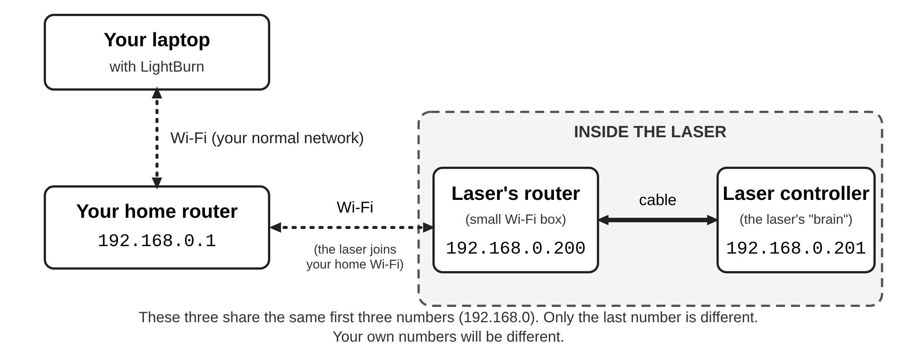
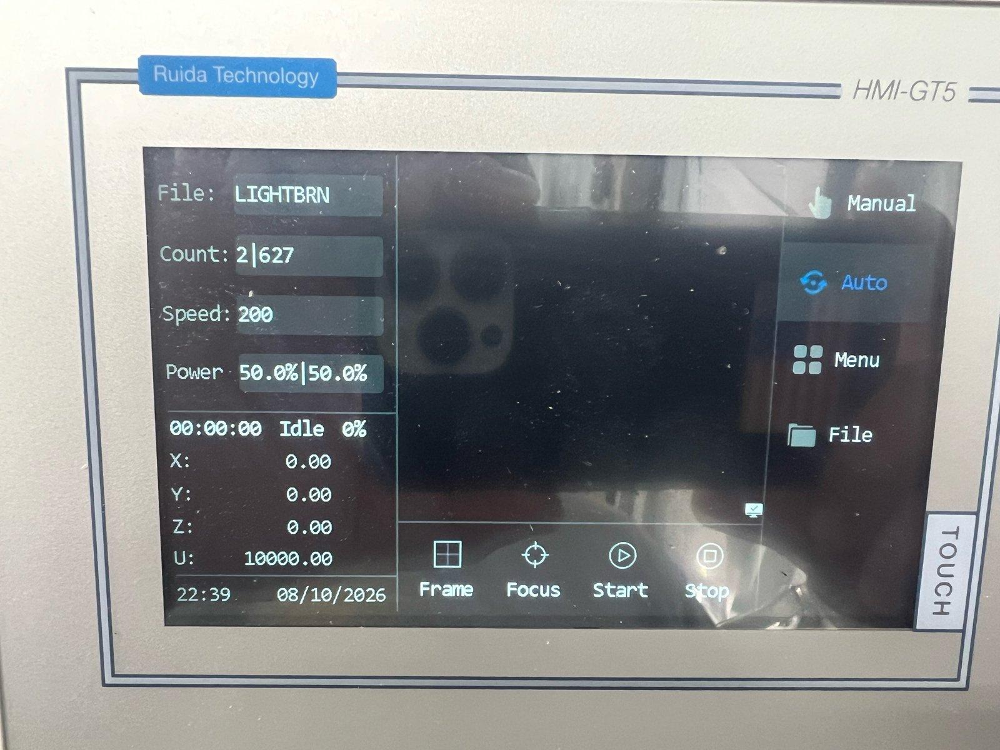
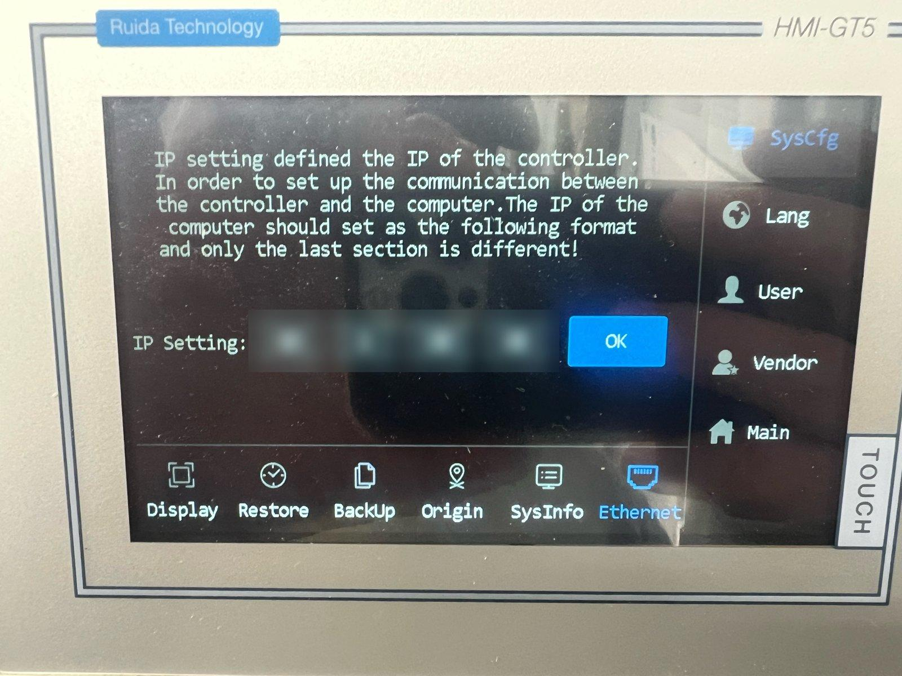

# Putting your OMTech Pro laser on your Wi-Fi

*A friendly, step-by-step guide for the OMTech Pro 2440, Pro 3655, and similar Pro-series lasers. When you're done, LightBurn on your laptop talks to the laser over your normal Wi-Fi. No USB cable, and no switching your laptop to a different network.*

Most owners never get this working, because the OMTech manual hardly mentions it. It *does* work, and once it's set up it stays set up. You don't need to be "a computer person." If you can follow a recipe carefully, you can do this.

**Plan on about an hour.** Read the whole guide once before you start, and keep a pen and paper handy.

> **Fine print:** this is a community write-up, not official OMTech help. Please read **"Credits and fine print"** near the end before you start. You use it at your own risk.

> **For network-savvy readers:** this guide is written for non-technical owners. The companion file **[TECHNICAL-NOTES.md](TECHNICAL-NOTES.md)** covers the actual setup (AP mode, AP-Client bridge, MAC translation, ports, and known quirks).

---

## First, two safety rules for the network cable jack

Your laser has a network cable socket on its side, labeled **Ethernet**. It looks like a slightly wider phone jack. Inside the laser, that socket is wired to a small Wi-Fi **router**. (A router is the kind of box that runs a home Wi-Fi network.) That's the part we'll be setting up.

> ⚠️ **Rule 1: Before setup, never plug the laser's Ethernet jack into your home network.**
> When it comes from the factory, the laser's router acts like a second home router. It hands out its own addresses to every device it can reach. If you cable it into your home router or a network switch, it can knock your other devices off the internet: phones, laptops, printers, cameras. It's a real headache to undo, and it has happened to other owners.

> ⚠️ **Rule 2: After setup, still never plug the laser's Ethernet jack into your home network.**
> Once you're done, the laser is already on your home network over Wi-Fi. A cable to your home network would give it a second path, which makes a "loop." A loop can slow down or freeze your whole network.

✅ **Plugging a laptop *directly* into the laser's Ethernet jack is fine**, before or after setup. Just never plug a cable from that jack into your home router, a switch, or a wall network jack.

This guide uses Wi-Fi for everything. You never need a network cable.

---

## A few words you'll see

You don't need to memorize these. Each one is also explained the first time it comes up.

- **IP address:** a device's "house number" on a network. It's four numbers with dots between them, like `192.168.0.25`.
- **Your home router:** the box from your internet company (or the one you bought) that makes your home or shop Wi-Fi.
- **The laser's router:** the small Wi-Fi box hidden inside the laser.
- **Settings page:** a web page that's built into the laser's router. You open it in your web browser (Chrome, Edge, Safari) to change its settings. Techie people call it the "admin page."
- **Controller:** the laser's "brain." It's the part you talk to through the touch screen and LightBurn. The OMTech uses a Ruida controller.

---

## What we're going to do (the big picture)

Right now, the laser's router makes its own little Wi-Fi network, called **OMTECH PRO 2440** (or OMTECH PRO 3655). To use it, your laptop has to leave your home Wi-Fi, so you lose the internet while you work.

We're going to change that. The laser's router will **join your home Wi-Fi**, the same way your phone does. Then it passes messages back and forth between the laser and your home network. Think of it as a mail carrier that delivers between two neighborhoods.

Then we give the laser its own house number on your home network, and tell LightBurn that number.

---

## Before you start

### What you need

- Your laser, plugged in and switched on.
- A laptop with Wi-Fi (Windows or Mac) with LightBurn installed.
- **Your home Wi-Fi name and password.** The laser's router can only join a **2.4 GHz** Wi-Fi network. Most home routers make one, often under the same name as their faster 5 GHz network, so this is usually fine. (If your router shows two names, one ending in "5G," choose the one *without* "5G.")
- About an hour, a pen, and paper.

### Find your home network's numbers

Every device on your home network has an address that starts with the **same first three numbers**. We need to know yours. Do this while your laptop is on your **normal home Wi-Fi**.

**On Windows:**
1. Click the **Start** button, type `cmd`, and press **Enter**. A black window opens.
2. Type `ipconfig` and press **Enter**.
3. Find the section that says **Wireless LAN adapter Wi-Fi**.
4. Write down the **IPv4 Address** (your laptop's number, for example `192.168.0.37`).
5. Write down the **Default Gateway** (your home router's number, for example `192.168.0.1`).

**On a Mac:**
1. Open **System Settings** and click **Wi-Fi**.
2. Click **Details…** next to the network you're connected to.
3. Click **TCP/IP**.
4. Write down the **IP address** (for example `192.168.0.37`) and the **Router** (for example `192.168.0.1`).

**You should see** four numbers with dots, like `192.168.0.37`. The first three numbers (here `192.168.0`) are your network's numbers.

*If you see something else,* like a number starting with `169.254`, your laptop isn't really connected. Reconnect to your home Wi-Fi and try again.

### Pick two new house numbers

You'll give out two new numbers on your home network. Keep your own first three numbers and change only the last one:

- one for **the laser's router**: we'll use **200**
- one for **the laser itself**: we'll use **201**

Numbers in the 200s are usually free, because most home routers hand out lower numbers first. (In Part 12 there's an optional step to make sure nothing else ever takes them.)

**This guide uses example numbers that start with `192.168.0`.** Yours might start with `192.168.1`, `192.168.86`, `10.0.0`, or something else. That's completely normal. **Wherever this guide says `192.168.0`, use your own first three numbers.** If yours also start with `192.168.1`, that's fine too. Just follow the steps as written.

### Your fill-in sheet

Copy this onto paper and fill in your own numbers:

| What | Example | Yours |
|---|---|---|
| Home Wi-Fi name | `MyHomeWiFi` | |
| Home Wi-Fi password | *(keep it private)* | |
| First three numbers | `192.168.0` | |
| Home router's number | `192.168.0.1` | |
| Laser's router's new number | `192.168.0.200` | |
| Laser's new number | `192.168.0.201` | |
| New password for the settings page (you'll make one up in Part 9) | | |

### One skill you'll use twice: giving your laptop a temporary number

Partway through, the laser's router stops handing out numbers on its own (that's on purpose). Twice, you'll type a number into your laptop by hand. Here's how. Come back to this box when a step sends you here.

**Windows 11:**
1. Open **Settings**, then **Network & internet**, then **Wi-Fi**.
2. Click the name of the network you're connected to (it will say something like **OMTECH PRO 2440 properties**).
3. Next to **IP assignment**, click **Edit**.
4. Change **Automatic (DHCP)** to **Manual**.
5. Turn on **IPv4**.
6. Type the **IP address** the step gives you.
7. In **Subnet mask**, type `255.255.255.0`. (If your box says **Subnet prefix length** instead, type `24`.)
8. Leave **Gateway** and **DNS** empty, and click **Save**.

**Mac:**
1. Open **System Settings**, then **Wi-Fi**.
2. Click **Details…** next to the network you're connected to, then click **TCP/IP**.
3. Change **Configure IPv4** to **Manually**.
4. Type the **IP Address** the step gives you.
5. In **Subnet Mask**, type `255.255.255.0`.
6. Leave **Router** empty, and click **OK**.

**To undo it later:** go back to the same screen and choose **Automatic (DHCP)** on Windows, or **Using DHCP** on a Mac.

---

## The setup, one step at a time

> 💾 **A tip about saving.** The laser's router gets its power from the laser, so turning the laser off also turns the router off. After you click **Apply** (应用设置) on any page, wait about a minute before you do anything else. Near the top right of the page there's a **Commit** (提交) button. If it's ever showing or highlighted, click it, because that saves your changes for good. On the laser this guide was tested on, the button stayed hidden and the settings saved on their own. Clicking it when you see it never hurts.

The settings page starts out in **Chinese**. Every step below shows the English name *and* the Chinese name, so you can follow along either way. Menus are written like this: **Advanced Settings → LAN** (高级设置 → 内网 LAN). That means "click Advanced Settings, then click LAN."

### Part 1: Join the laser's own Wi-Fi and open the settings page

**Step 1.** Turn the laser on. Wait **one full minute** so the laser's router can start up.

**Step 2.** On your laptop, open the Wi-Fi list and join **OMTECH PRO 2440** (or **OMTECH PRO 3655**). The password is `123456abc`. That's the factory password printed in the OMTECH manual.
*You should see:* your laptop says it's connected. It may also say "No internet." That's expected, so don't worry.
*If you don't see that network:* wait another minute, then refresh the Wi-Fi list. Make sure the laser is really on.

**Step 3.** Open your web browser. In the address bar at the very top (not a search box), type `http://192.168.1.1` and press **Enter**.
*You should see:* a small box pops up asking for a user name and password.

> 🔎 **Not fully confirmed yet:** we're fairly sure the factory address is `192.168.1.1`, but nobody has checked it on a brand-new laser. *If the page doesn't open:* look up your laptop's **Default Gateway** (Windows) or **Router** (Mac) the same way you did in "Find your home network's numbers," while you're still on the OMTECH Wi-Fi. Type that number into the browser instead.

**Step 4.** Type `admin` for the user name and `admin` for the password, then click **OK** or **Sign in**.
*You should see:* the router's main page, probably in Chinese, with a menu down the left side.
*If it says another user is already logged in* (请先注销另一用户后再尝试登录): only one device can be logged in at a time. Close the settings page on any other phone, tablet, or browser tab, wait a few minutes, and try again.

### Part 2: Switch the page to English (optional)

**Step 5.** In the box at the top right, find the small button next to **Commit** (提交) and **Logout** (注销). When the page is in Chinese, this button says **English**. Click it.
*You should see:* the page reloads in English. (To switch back later, the same button says **简体中文**.)
*If you can't find it:* no problem. Stay in Chinese and follow the Chinese names in each step.

### Part 3: Set your country

**Step 6.** Click **Advanced Settings → Wireless 2.4GHz** (高级设置 → 无线 2.4GHz), then the **General** tab (一般设置).

**Step 7.** Find **Region code** (区域代码). Choose your country, for example **USA**. Some lasers come set to "DB," which is a testing setting and isn't meant for home use.

**Step 8.** Scroll down and click **Apply** (应用设置). Wait one minute.
*You should see:* the page reloads and shows your country.
*If the laptop drops off the OMTECH Wi-Fi:* wait a minute, rejoin it, and open `http://192.168.1.1` again.

### Part 4: Turn off "router mode"

Right now, the laser's router acts like a second home router and hands out numbers. We're switching it to a quieter mode called **Access Point mode**, where it just passes things along.

**Step 9.** Click **Advanced Settings → Administration** (高级设置 → 系统管理), then the **Operation Mode** tab (工作模式).

**Step 10.** Choose **Access Point Mode (AP)** (无线交换机（AP）). *Don't* choose "Wireless Router Mode (Default)" (无线路由器（默认）).
*You should see:* a description that says NAT, Firewall and UPnP services are unavailable. That's exactly what we want.

**Step 11.** Click **Save** (保存) or **Apply** (应用设置).
*You should see:* the router restarts. Your laptop will probably drop off the OMTECH Wi-Fi for a minute or two.

**Step 12.** Wait two minutes. Then rejoin **OMTECH PRO 2440** if your laptop didn't rejoin on its own.
*You should see:* it connects, but your laptop may not get a proper number this time. That's because the laser's router has stopped handing them out, which is what we asked for.

**Step 13.** Give your laptop the temporary number `192.168.1.50`, using the box called **"One skill you'll use twice"** above.

**Step 14.** In your browser, open `http://192.168.1.1` again and log in with `admin` / `admin`.
*You should see:* the settings page again.

> 🔎 **Not confirmed yet:** we don't know for sure that the settings page stays at `192.168.1.1` right after this switch. *If it doesn't open:* wait two more minutes and try again. If it still won't open, see **"If something goes wrong"** below.

### Part 5: Give the laser's router its own number on your home network

**Step 15.** Click **Advanced Settings → LAN** (高级设置 → 内网 LAN), then the **LAN IP** tab (内网设置).

**Step 16.** Fill in the page like this. Use your own first three numbers.

| On the page | What to enter | Example |
|---|---|---|
| Get the LAN IP automatically? (自动获取 IP 地址) | **No** | No |
| IP Address (IP 地址) | the laser's router's new number | `192.168.0.200` |
| Subnet Mask (子网掩码) | always this | `255.255.255.0` |
| Default Gateway (默认网关) | your home router's number | `192.168.0.1` |
| DNS Server (DNS 服务器) | your home router's number again | `192.168.0.1` |

**Step 17.** Click **Apply** (应用设置). Wait one minute.
*You should see:* the page stops loading or shows an error. **That's normal.** The settings page has just moved to its new number.

**Step 18.** Stay on the OMTECH Wi-Fi. Change your laptop's temporary number to **your first three numbers plus 250**, for example `192.168.0.250`. Use the same **"One skill you'll use twice"** box.

**Step 19.** In your browser, open the laser's router's new number, for example `http://192.168.0.200`, and log in with `admin` / `admin`.
*You should see:* the settings page again, at its new home.
*If it doesn't open:* double-check that the first three numbers you typed in Step 16 and Step 18 match exactly. Then wait a minute and try again.

### Part 6: Connect the laser's router to your home Wi-Fi

**Step 20.** Click **Advanced Settings → Wireless 2.4GHz** (高级设置 → 无线 2.4GHz), then the **Bridge** tab (无线桥接).

**Step 21.** Fill in the page like this:

| On the page | Choose or enter |
|---|---|
| Wireless Operation Mode (无线工作模式) | **AP-Client + AP**. This keeps the OMTECH Wi-Fi on for now, so you can't lock yourself out. |
| Wireless AP-Client Role (无线 AP-Client 角色) | **LAN bridge**. *Not* "WAN (Wireless ISP)". (These are often shown in English even on the Chinese page.) |
| Radio Channel (无线信道) | tick **Autoseek** (自动搜寻), so it follows your home router automatically |
| Your Wi-Fi name (labeled **STA SSID** or similar) | pick your home Wi-Fi from the list, or type its name *exactly* (capital letters count) |
| Authentication Method (认证方式) | **WPA2-Personal** |
| WPA Encryption (WPA 加密) | **AES** |
| WPA Pre-Shared Key (WPA 密钥) | **your home Wi-Fi password** (not the laser's `123456abc`) |

**Step 22.** Click **Apply** (应用设置). Wait **two minutes**.
*You should see:* the page reloads. There's no big "success" message, but we'll check it in the next part.
*If you see a message about a wrong password* (密码错误): retype your home Wi-Fi password carefully and click Apply again.

### Part 7: Check that it worked, from your home Wi-Fi

**Step 23.** Set your laptop back to automatic (see **"To undo it later"** in the "One skill" box).

**Step 24.** Switch your laptop back to **your normal home Wi-Fi**.
*You should see:* the internet works on your laptop again.

**Step 25.** In your browser, open the laser's router's new number, for example `http://192.168.0.200`.
*You should see:* the login box, then the settings page. **This is the big moment.** It means the laser's router has joined your home Wi-Fi. 🎉
*If it doesn't open:* go back to the OMTECH Wi-Fi, set your laptop's temporary number to `192.168.0.250` again, open `http://192.168.0.200`, and check Part 6 carefully. Most often it's the Wi-Fi name or password, or a home network that's 5 GHz only.

### Part 8: Turn off the laser's own Wi-Fi network

The laser doesn't need its own network anymore. Leaving it on would give a stranger an easy way in, because its password is printed in the manual.

**Step 26.** While on your home Wi-Fi, go back to **Advanced Settings → Wireless 2.4GHz → Bridge** (高级设置 → 无线 2.4GHz → 无线桥接).

**Step 27.** Change **Wireless Operation Mode** (无线工作模式) to **AP-Client (AP is disabled)** (AP-Client（禁用 AP）). Click **Apply** (应用设置). Wait one minute.
*You should see:* the **OMTECH PRO 2440** network disappears from your laptop's Wi-Fi list within a few minutes, and the settings page still opens at `http://192.168.0.200`.
*If the settings page stops opening:* wait two minutes and try again. If it still won't open, see "If something goes wrong."

### Part 9: Change the settings-page password

Right now anyone on your network could log in with `admin` / `admin`.

**Step 28.** Click **Advanced Settings → Administration** (高级设置 → 系统管理), then the **System** tab (系统).

**Step 29.** Type a new password in **New password** (新密码), and again in the box below it (再次输入新密码). Write it on your fill-in sheet.

**Step 30.** Click **Apply** (应用设置). If the **Commit** (提交) button is showing, click it too.
*You should see:* the browser asks you to log in again. Use `admin` and your **new** password.

### Part 10: Give the laser its number, on the laser's touch screen

**Step 31.** On the laser's touch screen, tap **Menu** on the right side.

**Step 32.** Tap **SysCfg** at the top right, then tap **Ethernet** at the bottom right.
*You should see:* a screen that says **IP Setting** with four number boxes and an **OK** button, like the photo below.

**Step 33.** Tap each box and type the laser's new number, one part per box. For example: `192`, `168`, `0`, `201`.
The screen's note says the computer's number must match except for the last part. That's why we put everything on your home network's first three numbers.

**Step 34.** Tap **OK**.

**Step 35.** Turn the laser **off**, wait 10 seconds, and turn it back **on**. Then wait one full minute while the laser's router starts up.
*You should see:* the laser starts normally. (The settings you made in the router are kept.)

### Part 11: Connect LightBurn

**Step 36.** Make sure your laptop is on your home Wi-Fi. Open LightBurn.

**Step 37.** In the **Laser** window, click **Devices**. Then click **Create Manually**.

**Step 38.** Choose **Ruida** and click **Next**.

**Step 39.** Choose **Ethernet/UDP** and click **Next**.

**Step 40.** Type the laser's new number, for example `192.168.0.201`, and click **Next**.

**Step 41.** Give it a name, like "OMTech Wi-Fi." Enter your bed size (for a Pro 2440, **1000** by **600** mm; for other models, use the work area in your manual). Click **Next**.

**Step 42.** Choose the corner where your laser head goes when it homes, then click **Next** and **Finish**.

**Step 43.** Back in the Laser window, choose your new device from the drop-down list.
*You should see:* the status says **Ready**. You're on Wi-Fi! 🎉
*If Windows asks whether LightBurn may use the network,* click **Allow**.
*If it says Disconnected:* check that the number on the laser's touch screen matches the number in LightBurn exactly, and that your laptop is on your home Wi-Fi. Then turn the laser off and on once more.

Your old USB setup in LightBurn still works. You can keep both and pick whichever you like.

### Part 12 (optional but recommended): Tell your home router to save those two numbers

Your home router hands out numbers automatically. Very occasionally, it might hand **200** or **201** to a new phone or TV, and then the laser would stop answering. You can prevent that. This part happens in *your home router's* app or settings page, which looks different for every brand. If this feels like too much, it's fine to skip it, or ask whoever set up your internet to help.

- Look for a setting called **DHCP range**, **IP pool**, or **address range**. Make sure it ends *below* 200 (for example, at 199).
- Your router might also have **address reservation**. Here's a surprise: the laser's router and the laser will show up as **two numbers with the same device ID** (the "MAC address"). That's normal for this setup, so don't worry. Changing the range above is the simpler fix.

---

## If something goes wrong

**"The settings page won't open."**
- Wait two minutes. The router is slow to restart.
- Check which Wi-Fi your laptop is on. Before Part 7 that's the OMTECH Wi-Fi; after Part 7 it's your home Wi-Fi.
- Make sure you typed `http://` and the number in the **address bar**, not a search box.
- Before Part 5, your laptop's temporary number should start `192.168.1`. Between Part 5 and Part 7, it should start with your home numbers.

**"It says another user is logged in"** (请先注销另一用户后再尝试登录).
Only one device can use the settings page at a time. Close it everywhere else, click **Logout** (注销) if you can, and wait a few minutes.

**"Part 7 didn't work, and I already turned off the OMTECH Wi-Fi."**
The easiest fix is to start over with a factory reset (below).

**"LightBurn says Disconnected."**
- The first three numbers on the laser's screen must match your laptop's first three numbers.
- Turn the laser off and on, and wait a full minute.
- Check that your laptop is on your home Wi-Fi, not a guest network.

**"It used to work, and now it doesn't."**
- If your home router was replaced or reset, its numbers may have changed. Check your home numbers again ("Find your home network's numbers").
- The laser's router sits inside a metal cabinet. If your home router is far away, the signal may be weak. Moving your home router closer, or adding a Wi-Fi extender, can help.

**Starting over: factory reset**

> 🔎 **Not confirmed yet:** nobody has tested the reset on this exact laser yet. Here's what's expected, based on the same router software used elsewhere.

- **If you can still open the settings page:** go to **Advanced Settings → Administration → Settings** (高级设置 → 系统管理 → 配置管理). Find **Factory Default** (恢复出厂模式) and click **Reset** (重置). Wait a few minutes. Then start again at Part 1.
- **If you can't open the settings page:** the router has a small **RESET** button. The router is inside the cabinet, behind the electronics access doors. ⚠️ **Unplug the laser from the wall before you open any access door.** There is high voltage inside. Once you've found the router, close up and power on so the router can start. With the router fully started (at least one minute after power-on), press and hold RESET for about 10 seconds. *Don't* hold it while turning the power on, because that can put the router into a special repair mode. If you're not comfortable reaching the button safely with the power on, ask for help in an owner community.

---

## Menu names: English and Chinese

| English | 中文 |
|---|---|
| Advanced Settings | 高级设置 |
| Wireless 2.4GHz → General | 无线 2.4GHz → 一般设置 |
| Wireless 2.4GHz → Bridge | 无线 2.4GHz → 无线桥接 |
| Region code | 区域代码 |
| Wireless Operation Mode | 无线工作模式 |
| AP-Client + AP | AP-Client + AP |
| AP-Client (AP is disabled) | AP-Client（禁用 AP） |
| Wireless AP-Client Role | 无线 AP-Client 角色 |
| LAN bridge / WAN (Wireless ISP) | (usually shown in English) |
| Radio Channel / Autoseek | 无线信道 / 自动搜寻 |
| Wireless name (SSID) | 无线名称 |
| Authentication Method | 认证方式 |
| WPA Encryption | WPA 加密 |
| WPA Pre-Shared Key | WPA 密钥 |
| LAN → LAN IP | 内网 LAN → 内网设置 |
| Get the LAN IP automatically? | 自动获取 IP 地址 |
| IP Address / Subnet Mask / Default Gateway | IP 地址 / 子网掩码 / 默认网关 |
| DNS Server | DNS 服务器 |
| Administration | 系统管理 |
| Operation Mode | 工作模式 |
| Wireless Router Mode (Default) | 无线路由器（默认） |
| Access Point Mode (AP) | 无线交换机（AP） |
| System | 系统 |
| New password / Retype new password | 新密码 / 再次输入新密码 |
| Settings (backup, restore, factory default) | 配置管理 |
| Factory Default → Reset | 恢复出厂模式 → 重置 |
| Apply | 应用设置 |
| Save | 保存 |
| Commit (save for good) | 提交 |
| Logout | 注销 |

*These labels come from the router software's Chinese language file. Your unit's wording may differ slightly.*

---

---

## Credits and fine print

**Who made this**

- Originally solved by RB & HW.
- Deep dive and write-up by Grok Bot.

**Use at your own risk**

- This guide comes with no warranty of any kind. Use it at your own risk, and your mileage may vary.
- Just because this hardware was in our laser doesn't mean it will be in yours. OMTech changes parts without notice. For example, they switched the power connector from C13/C14 to PowerCon with no announcement. The router inside your laser, its menus, its default settings, and its wiring may be different from what we found.
- Take a photo of every screen before you change anything, so you can see what things looked like to begin with.

**Support**

- We aren't taking requests, and we won't explain this any deeper than it's written here.
- If you get stuck, call a local computer repair company or a friendly nerd.

---

## Sources

- OMTech Pro 2440 user manual, §3.8.4 "Connection Through Wi-Fi" and §6.7.1 SysCfg: https://www.manualslib.com/manual/3532616/Omtech-Pro-2440.html
- OMTech Pro 3655 manual (same Wi-Fi section): https://7cad390533514c32acc8-75d23ce06fcfaf780446d85d50c33f7b.ssl.cf6.rackcdn.com/skuSpecification/DABDB66FA51E94B7772995BA219D47CB.pdf
- OMTech Help Center, Pro FAQ (integrated Wi-Fi): https://help.omtech.com/en/pro-series/faq
- Reddit: "Omtech Pro built in router taking over my home network": https://www.reddit.com/r/OmtechLaser/comments/1qd8cuc/omtech_pro_built_in_router_taking_over_my_home/
- LightBurn forum: old router as a bridge for an OMTech Polar: https://forum.lightburnsoftware.com/t/solved-old-wifi-router-as-bridge-for-omtech-polar-350-to-connect-via-home-wifi-network/105635
- LightBurn forum: Ruida is fixed-IP only; reserve the address: https://forum.lightburnsoftware.com/t/quick-question-for-someone-that-knows-about-router-settings-static-ip/82628
- Padavan firmware menu strings (English): https://github.com/andy-padavan/rt-n56u/blob/master/trunk/user/www/dict/EN.footer
- Padavan Simplified-Chinese strings: https://github.com/gorden5566/padavan
- Padavan AP-Client "LAN bridge" vs "Wireless ISP" (Chinese): https://ioozu.com/post-3060.html
- Padavan reset-button behavior (Chinese): https://www.cnblogs.com/wangdac/p/13614220.html

